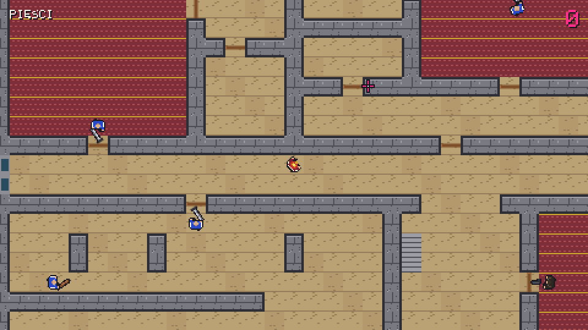
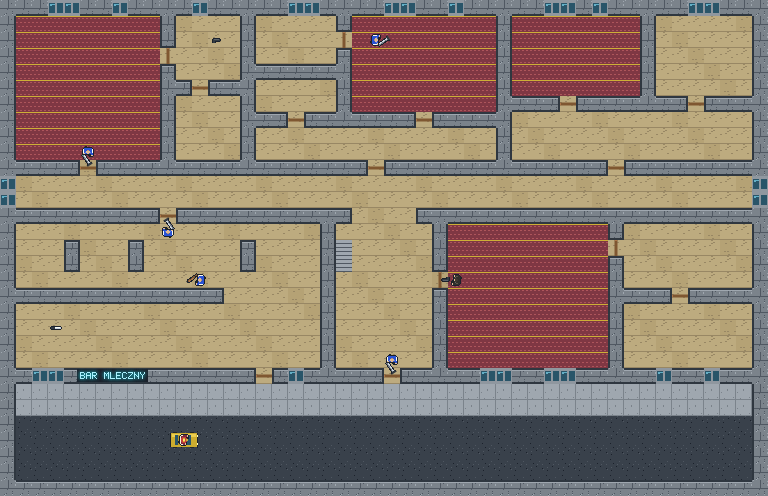
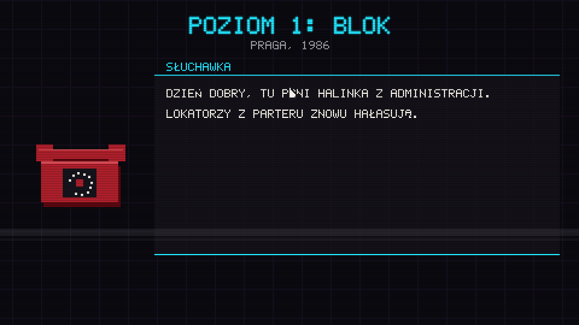
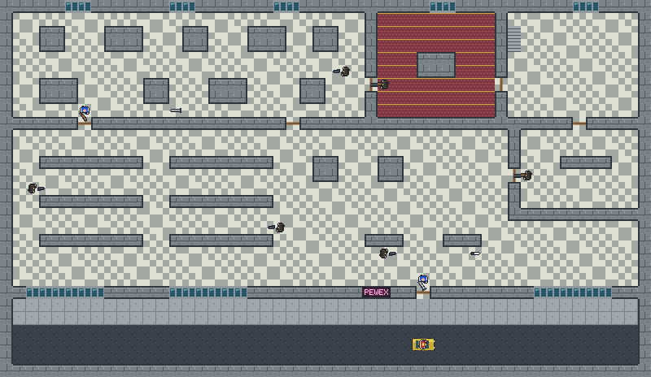
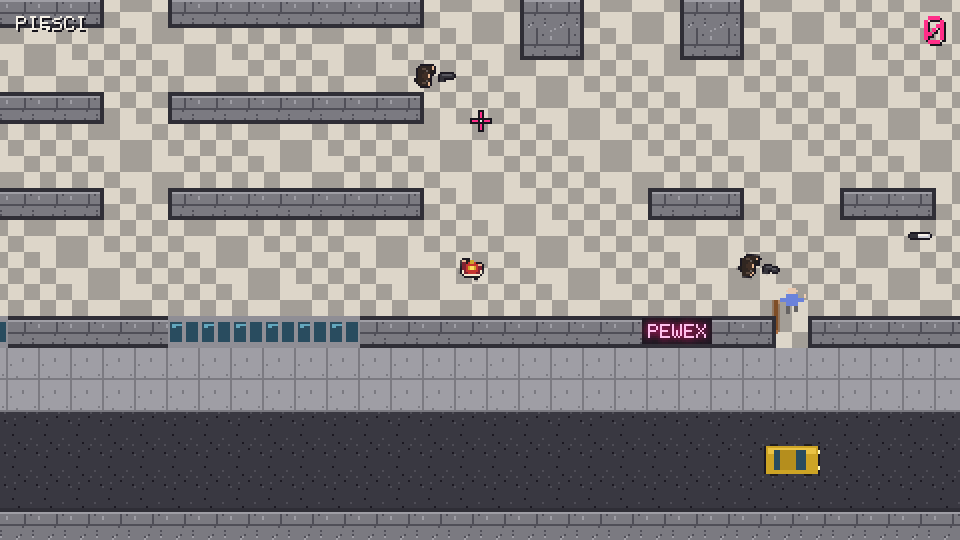
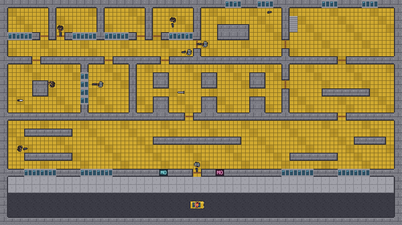
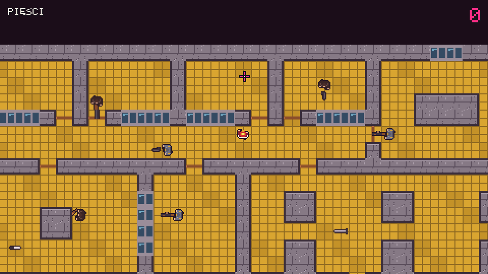

# Hotline Warsaw

**Warszawa, 1986.** The phone rings, someone you never met gives you an address, and you drive your
Fiat 126p to a concrete block in Praga. Hotline Warsaw is a Hotline Miami-style top-down shooter set in
PRL-era Warsaw. Combat is fast and every hit kills, on both sides. You kick doors into
tracksuited dresiarze, pick up pipes and P-64 pistols, chain kills for combo multipliers, and restart
instantly when you die. The block is grey wielka płyta concrete, lit by cyan and magenta neon and a
synthesized soundtrack. It runs in the browser with plain HTML5 canvas and Web Audio. There is no
build step and nothing to install.

**▶ Play: https://maciejsulewski.github.io/hotline-warsaw/**



## Play locally

Clone or download the repository and open `index.html` in current Chrome or Firefox. It works
straight from `file://` and needs no server. Audio starts after the first click.

## Controls

| Input | Action |
|---|---|
| WASD | move |
| Mouse | aim |
| Left click (hold for auto) | attack / fire |
| Right click | throw held weapon; if empty-handed, pick up nearest weapon |
| Space | execute an adjacent downed enemy |
| Shift | look ahead toward the cursor |
| R | restart level |
| M | mute |
| Esc | back to level select |

Push doors open by walking into them. A door swung fast into an enemy knocks them down, and
**Space** finishes them off for a bonus. When the last enemy dies, **WRACAJ DO AUTA**: get back to the
car to finish the level.

## Masks

You pick a mask before each attempt. It stays on when you restart.

| Mask | Perk | Unlock |
|---|---|---|
| Lajkonik | none | start |
| Bolek | start with a knife | finish level 1 |
| Lolek | door knockdowns last 5 s | grade B or better on level 1 |
| Czapka milicjanta | survive the first hit, once per attempt | finish level 2 |
| Pan Kleks | +20% move speed | grade A or better on any level |

## Screenshots

| Level 1 "Blok", ground floor | Phone call |
|---|---|
|  |  |
| **Level 2 "Pewex", ground floor** | **Pewex shop floor** |
|  |  |
| **Level 3 "Komenda", ground floor** | **Komenda cell block** |
|  |  |

## Running the tests

The tests use only Node's built-in test runner. Node 22 or newer is needed for the glob:

```sh
node --test "test/**/*.test.js"
```

The game logic (math, world, AI, combat, scoring, levels, saves) is pure JavaScript and is tested
headless. The level tests validate every level, check that every enemy and weapon is reachable from
the car, and play a scripted clear-and-escape run through the simulation.

## Credits & licence

Design, code, pixel art and synthesized music by Maciej Sulewski, built with Claude Code. Inspired by
*Hotline Miami* (Dennaton Games). This is a fan homage with no affiliation.

Released under the [MIT licence](LICENSE).
